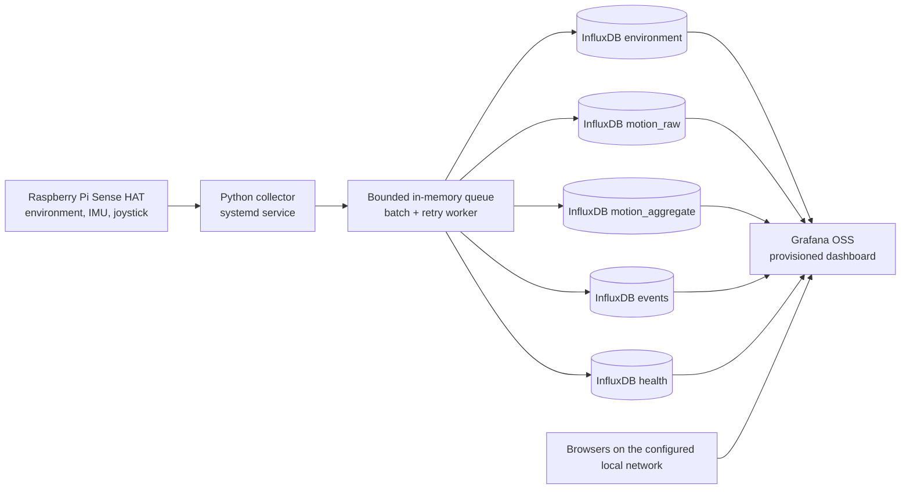

# SenseHAT Observatory

SenseHAT Observatory is a self-hosted Raspberry Pi project for environmental,
motion and joystick monitoring with the official Raspberry Pi Sense HAT. It
stores measurements in InfluxDB 2.x and provisions a Grafana OSS dashboard. The
collector is a Python service managed by systemd; the database and dashboard
run in Docker Compose.

The project is designed for local, self-hosted deployment. The installer binds
services to a configurable local interface address and uses ports 3000 and
8086 by default. Those ports can be changed to fit an existing network setup.

## Architecture



Retention values shown in the architecture are defaults from
[`config/observatory.example.yaml`](config/observatory.example.yaml); each is
configurable there. Motion is sampled at 10 Hz by default, stored raw for 7
days, and summarized into one-minute min/max/mean values for 365 days. The
environment is sampled every 30 seconds by default. The collector uses a
bounded queue so sensor reads do not wait for database writes. Temporary write
failures are retried; queue overflow or exhausted retries are logged and
included in health telemetry.

## Hardware and software requirements

- Raspberry Pi running 64-bit Raspberry Pi OS (Debian-based, `aarch64`), with a
  working network connection.
- Official Raspberry Pi Sense HAT installed and attached.
- Docker Engine and the Docker Compose v2 plugin (the installer attempts to
  install these from Raspberry Pi OS packages).
- I²C enabled and `/dev/i2c-1` available; joystick input devices available
  under `/dev/input`.
- A local IPv4 address assigned to the Pi and reachable from the clients that
  should access Grafana.

The installer checks for a Raspberry Pi, 64-bit Raspberry Pi OS, architecture,
I²C, input devices, sensor API access and port conflicts. InfluxDB 2.x does not
publish an ARMv7 image, so 32-bit Raspberry Pi OS is not supported by this
Compose stack. A preflight reads environmental, IMU, orientation and joystick
APIs as the collector service user without writing to the LED matrix. If the
HAT is absent or unreadable, setup stops before starting the database stack.
Where I²C is disabled, enable it with `sudo raspi-config` under **Interface
Options → I2C**, reboot, and run setup again.

## Install on a Raspberry Pi

Clone the published repository on the Raspberry Pi:

```sh
git clone https://github.com/<owner>/sensehat-observatory.git
cd sensehat-observatory
sudo ./scripts/install.sh
```

Replace `<owner>` with the account or organization hosting your fork, or use
the URL for another published clone.

The installer:

1. Verifies Raspberry Pi OS and Sense HAT device access.
2. Installs Docker/Compose and the OS-provided `python3-sense-hat` package.
3. Creates a mode-600 `.env` containing generated InfluxDB and Grafana
   credentials if one does not already exist. Existing credentials are not
   overwritten.
4. Creates a Python virtual environment with access to the OS Sense HAT
   bindings, installs the collector, and installs its systemd unit.
5. Starts InfluxDB and Grafana, applies configured bucket retention, and
   enables the collector service.

Do not copy real credentials into source control.

Setup reports the dashboard URL, normally `http://<pi-lan-ip>:3000`. Generated
Grafana login details are in the private `.env` file:

```sh
sudo grep -E '^(GF_SECURITY_ADMIN_USER|GF_SECURITY_ADMIN_PASSWORD)=' .env
```

Keep the credentials private. These are bootstrap credentials: Grafana's admin
password must be rotated in Grafana after first login, and changing its
environment variable does not reset an existing Grafana database. InfluxDB
initialization variables likewise do not recreate or rotate credentials after
the data volume has been initialized. Rotate InfluxDB tokens with its supported
authorization tools, then update the collector and Grafana token configuration.
InfluxDB is available to clients on the configured local interface for
diagnostics and collector writes; it is not required for normal dashboard
viewing.

## Configuration

The installed collector configuration is
`/etc/sensehat-observatory/observatory.yaml`. The example file documents every
supported key:

```yaml
device_id: sensehat-observatory-01
location:
  name: Living room
  building: null
  floor: null
  room: null
sampling:
  environment_interval_seconds: 30
  imu_frequency_hz: 10
motion:
  movement_threshold_g: 0.25
  aggregation_interval_seconds: 60
retention:
  environment_days: 365
  motion_raw_days: 7
  motion_aggregate_days: 365
  hardware_events_days: 365
  health_days: 30
display:
  enabled: false
```

Set location labels to match the installation. Location is metadata only; the
Sense HAT has no GPS and the collector does not infer or store coordinates.
Retention and sampling values must be positive; IMU rate is limited to 100 Hz,
sampling/aggregation intervals to 86400 seconds, and retention to 36500 days.
After editing configuration, apply it with:

```sh
sudo ./scripts/install.sh
sudo systemctl restart sensehat-observatory
```

The installer synchronizes bucket retention from this YAML. The LED matrix is
never used as a sensor. With `display.enabled: false` (the default), the
collector does not write to the display. If explicitly enabled, it writes a
static status icon only when status changes (startup, first degradation and
shutdown); it does not continuously overwrite the matrix.

InfluxDB credentials and URL are read from the root-managed environment file
`/etc/sensehat-observatory/collector.env`; they are not accepted in YAML.
Service credentials live only in `.env`, which is ignored by Git and created
with restrictive permissions. `.env.example` contains placeholders for
reference only; do not use it as production credentials.

`LAN_BIND_IP`, `GRAFANA_PORT`, and `INFLUX_PORT` are in `.env`. `LAN_BIND_IP`
must be the local IPv4 address assigned to the Pi on the interface clients use.
Change the ports there if defaults conflict with other services, and set
`INFLUX_URL` in the same file to
`http://<LAN_BIND_IP>:<INFLUX_PORT>`. Re-run the installer to validate and
apply changes. The installer rejects non-private addresses to reduce accidental
public exposure. This project does not configure router or firewall rules;
keep services limited to a trusted local network.

## Running and operating

The collector is started at boot and restarted on failure by systemd:

```sh
sudo systemctl status sensehat-observatory
sudo journalctl -u sensehat-observatory -f
sudo systemctl restart sensehat-observatory
```

It shuts down on SIGTERM/SIGINT and attempts to flush queued data. When InfluxDB
is unavailable, writes are retried with bounded exponential backoff; the
collector continues sampling until the queue is full. Errors and dropped
points are logged and recorded in the health measurement when possible.

The Grafana dashboard **SenseHAT Observatory** is provisioned automatically.
It refreshes every 30 seconds, supports the 1 hour, 6 hour, 24 hour, 7 day and
30 day ranges, and includes:

- Current temperature, humidity, pressure, dew point, collector status and
  latest sample timestamp.
- Temperature history/comparison, humidity, pressure, dew point, absolute
  humidity and daily temperature/humidity/pressure minimum, maximum and
  average.
- Accelerometer (g), gyroscope (rad/s), magnetometer (µT), pitch/roll/yaw and
  compass (degrees), plus movement detection.
- Joystick, orientation and movement events; collector status, sensor errors,
  failed writes, queue depth and dropped points.

## Measurements and units

| Measurement | Fields / units |
|---|---|
| `environment` | Temperature from humidity and pressure sensors (°C), relative humidity (%), pressure (hPa), dew point (°C), absolute humidity (g/m³), temperature difference (°C). |
| `motion` | Accelerometer (g), gyroscope (rad/s), magnetometer (µT), movement flag. |
| `orientation` | Pitch, roll, yaw and compass heading (degrees). |
| `motion_aggregate` | Stored in its `motion_aggregate` bucket; configured-window min, max and mean per numeric motion field, plus movement flag. |
| `hardware_events` | Joystick direction and press/release action; movement threshold and orientation-change events. |
| `collector_health` | Status, sensor/write error counts, queue depth, dropped points, last successful sensor update times. |

Measurements are tagged with `device_id`, location name and configured
building/floor/room labels. Sensor values use the documented official
`sense-hat` Python APIs: accelerometer raw values in g, gyroscope raw values in
radians/second, magnetometer raw values in microtesla, orientation and compass
in degrees, pressure in hPa, and environmental temperature in °C. Min/max/
average environmental values are computed in Grafana over daily windows; motion
min/max/average values are written by the collector at the configured interval.

Movement detection compares consecutive accelerometer vectors and emits a
movement event when the vector delta meets `movement_threshold_g`. Validate
this threshold with the physical installation; the default is a starting point,
not a calibrated safety or activity detector. Orientation-change events are
emitted when pitch, roll or yaw changes by at least 5 degrees between samples.

## Docker services and network binding

Compose configuration is in [`deploy/compose.yaml`](deploy/compose.yaml);
Grafana data source and dashboard providers are provisioned from
`deploy/grafana/provisioning/`. Dashboard JSON is generated by
`scripts/generate_dashboard.py`. Named volumes persist InfluxDB data/config and
Grafana data. The installer publishes services only on the configured local
interface and checks for port collisions. It does not configure DNS, web
servers, firewalls, or routers.

Manual Compose operation (after running the installer, from the repository
root):

```sh
sudo docker compose --env-file .env --project-directory "$PWD" \
  -f deploy/compose.yaml up -d
sudo docker compose --env-file .env --project-directory "$PWD" \
  -f deploy/compose.yaml ps
sudo docker compose --env-file .env --project-directory "$PWD" \
  -f deploy/compose.yaml logs -f
```

## Troubleshooting

- **Installer says it is not on Raspberry Pi OS:** run it on the Pi itself, not
  the development computer.
- **`/dev/i2c-1` missing:** enable I²C in `raspi-config`, reboot, and rerun.
- **No joystick events:** check `/dev/input`, `input` group access, and the
  systemd journal. The joystick API behavior must be confirmed on the actual
  Sense HAT.
- **Collector cannot import `sense_hat`:** reinstall Raspberry Pi OS package
  `python3-sense-hat`; the virtual environment is created with
  `--system-site-packages` to expose its bindings.
- **Port is already listening:** change `GRAFANA_PORT` or `INFLUX_PORT` in
  `.env` to unused ports allowed by the installer.
- **Dashboard says no data:** check the collector service, InfluxDB health,
  `INFLUX_URL`, organization, token and bucket in
  `/etc/sensehat-observatory/collector.env`.
- **Writes keep retrying:** inspect `sudo journalctl -u sensehat-observatory`
  and `docker compose ... logs influxdb`; verify LAN reachability and disk
  space. The writer queue is bounded; sustained outages can cause logged,
  metered drops.
- **Temperature differs from a reference thermometer:** the Sense HAT board's
  heat and local placement can influence readings. Compare the two sensor
  temperatures and install away from heat sources; do not assume calibration.

## Backup and restore

Backups stop the collector and Compose services briefly so data volumes are
consistent. They contain credentials and should be encrypted or stored with
private permissions:

```sh
sudo ./scripts/backup.sh
sudo ./scripts/backup.sh /path/to/private-backup
```

The backup includes all Compose volumes, `.env`, collector environment,
operator configuration and the collector's local Sense HAT calibration state.
The archive is sensitive; store it securely and off-device. To restore a backup
onto an installed Observatory, verify the backup contents, then run:

```sh
sudo CONFIRM_RESTORE=YES ./scripts/restore.sh /path/to/private-backup
```

Restore replaces the Observatory's named Docker volumes and configuration.
Review `LAN_BIND_IP` in the restored `.env` if restoring to a different Pi,
then verify the service and dashboard. Never restore an untrusted archive.

## Updating

Clone from the repository or fork you want to deploy, and keep the working tree
clean. Then run on the Pi:

```sh
sudo ./scripts/update.sh
```

The update script fast-forwards the current branch only and reruns the installer.
It refuses to overwrite a dirty checkout or run without a Git remote. Back up
first if the system contains data you cannot recreate.

## Development and hardware validation

On a development machine, the pure logic, mocked sensors, queue and dashboard
contract can be tested without Sense HAT hardware:

```sh
python3 -m venv .venv
. .venv/bin/activate
python -m pip install -e '.[test]'
pytest
python scripts/generate_dashboard.py
docker compose --env-file .env.example --project-directory "$PWD" \
  -f deploy/compose.yaml config --quiet
```

Hardware-specific behavior is not mocked in the production service. Before
relying on a deployment, verify real environmental values, IMU units,
orientation, joystick press/release events, systemd device permissions, local
network access and multi-day operation on the target Raspberry Pi. Automated
tests cannot replace these physical checks.

## Contributing

Contributions are welcome. See [`CONTRIBUTING.md`](CONTRIBUTING.md) for
development setup, testing, security and hardware-change guidelines.

## License

MIT; see [LICENSE](LICENSE).
